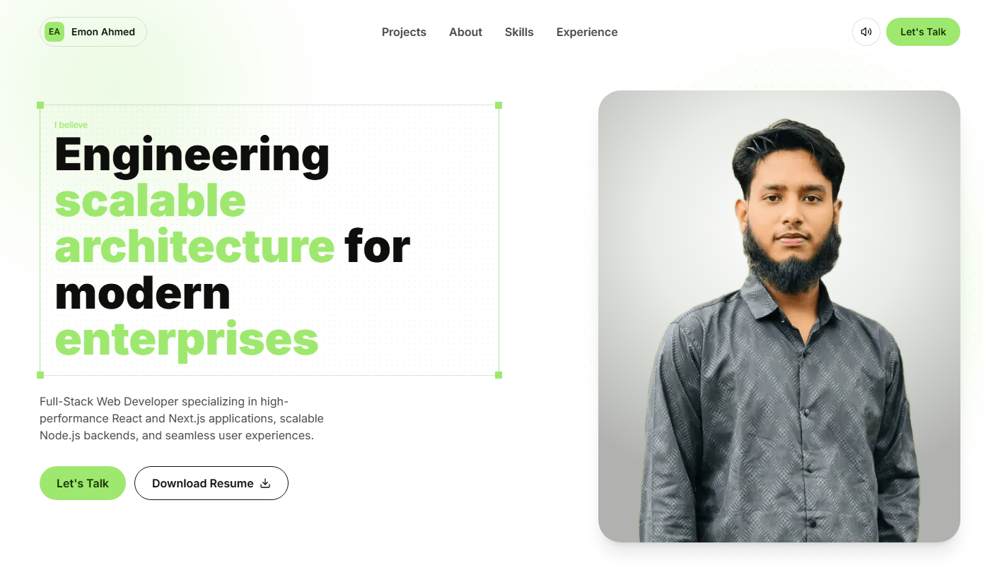

# Emon Ahmed — Portfolio

Personal portfolio of **Emon Ahmed**, Full-Stack Web Developer.



## About me

I am a Full-Stack Web Developer based in Tangail, Bangladesh, focused on building fast, reliable and user-centred web applications. My core expertise is React and Next.js on the frontend, supported by scalable Node.js services on the backend. I care about clean architecture, measurable performance and interfaces that feel effortless to use.

### Current role

**Frontend Developer — Vzure Solution** · Nov 2025 – Present

- Optimise and refactor the Next.js codebase, improving performance across key pages.
- Build interfaces for private, client-confidential AI projects.
- Design and implement visual workflow editors with React Flow and shadcn/ui, making complex processes easier to configure and follow.

### Previous experience

- **Frontend Developer Intern — UiHut** · Sep 2023 – Dec 2023: applied UI optimisation, clean-code practices and caching strategies across themes, delivering noticeably faster load times.
- **Theme Developer — SwipePages** · May 2023 – Aug 2023: partnered with Figma designers to translate complex designs into polished landing-page components for a drag-and-drop page builder.

### Core skills

| Area         | Technologies                                          |
| ------------ | ----------------------------------------------------- |
| Languages    | TypeScript, JavaScript                                |
| Frontend     | React, Next.js, React Native, Tailwind CSS, shadcn/ui |
| State & data | Redux, TanStack Query                                 |
| Backend      | Node.js, Express, REST APIs                           |
| Databases    | PostgreSQL, MongoDB, Prisma                           |
| Tooling      | Git, GitHub, Docker, Vercel, Figma                    |

I am always open to discussing new opportunities, collaborations and interesting product ideas.

## What's on the site

- **Hero** — introduction and studio-style portrait
- **Skills** — capability cards and a core-tech ticker
- **AI skills** — the agent skills and tools in my daily workflow, with copy-ready install commands
- **Experience** — timeline of my roles
- **Projects** — screenshot cards that open a detail modal with highlights, tech stack and links
- **Contact** — email, WhatsApp, Messenger and profile links

Small touches: a pinned navbar on scroll, soft click sounds (with a mute toggle), a custom 404 page and a preloader.

## Built with

- [Next.js 16](https://nextjs.org) (App Router) + React 19 + TypeScript
- [Tailwind CSS v4](https://tailwindcss.com) — design tokens live in `app/globals.css`
- [Radix UI](https://www.radix-ui.com) / shadcn, `lucide-react` and `react-icons`
- Web Audio API for the click sounds — no audio files

The visual design follows the brand system in [`DESIGN.md`](DESIGN.md).

## Run it locally

Requires Node.js 22 and [pnpm](https://pnpm.io).

```bash
pnpm install
pnpm dev      # http://localhost:3000
pnpm build    # production build
pnpm lint
```

### Run with Docker

The `Dockerfile` builds a small production image from Next.js's standalone output and runs it as a non-root user.

```bash
docker build -t emon-portfolio .
docker run -p 3000:3000 emon-portfolio   # http://localhost:3000
```

Or use the two Compose files:

| File                | Mode                                          | Command                                                                  |
| ------------------- | --------------------------------------------- | ------------------------------------------------------------------------ |
| `compose.dev.yaml`  | `next dev` with hot reload                    | `pnpm docker:dev` (`docker compose -f compose.dev.yaml watch`)           |
| `compose.prod.yaml` | production server, health check, auto-restart | `pnpm docker:prod` (`docker compose -f compose.prod.yaml up --build -d`) |

Stop either with `docker compose -f <file> down`. The dev file uses Compose Watch, which syncs each saved file into the container so hot reload works on Windows and macOS too.

## Contact

- Email: [imonshomon@gmail.com](mailto:imonshomon@gmail.com)
- GitHub: [@emonahmed123](https://github.com/emonahmed123)
- LinkedIn: [in/emon-ahmed123](https://www.linkedin.com/in/emon-ahmed123/)
